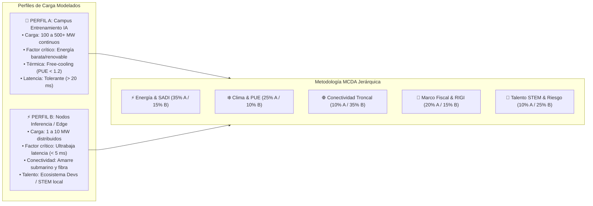

# ⚡ Viabilidad de Data Centers y Campus de IA en Argentina

[](https://www.python.org/)
[](https://react.dev/)
[](https://vitejs.dev/)
[](https://tailwindcss.com/)
[](docs/CHANGELOG.md)
[-38bdf8.svg)](https://epsg.io/4326)
[](bi/guia_powerbi_modelo_estrella.md)

> **Observatorio de Infraestructura y viabilidad técnica, energética, climática y regulatoria multicriterio (MCDA), segmentación no supervisada (K-Means), análisis Monte Carlo y proyecciones prospectivas 2026–2036 en las 24 jurisdicciones de Argentina (23 provincias + CABA).**


---

## 1. Propuesta de Valor y Problema de Negocio

El despliegue global de infraestructura para Inteligencia Artificial enfrenta un cuello de botella energético, térmico y de conectividad sin precedentes. Sin embargo, evaluar la radicación de centros de datos bajo un criterio único es un error estratégico de alto costo. 

Este proyecto modela de forma explícita y desacoplada dos perfiles de demanda con requerimientos técnicos diametralmente opuestos:



### El dilema técnico fundamental:
- **Campus de Entrenamiento IA (High Density):** Un clúster de miles de aceleradores (GPUs/TPUs) puede entrenar modelos fundacionales en zonas remotas siempre que disponga de gigavatios de energía limpia y climas fríos para evitar el consumo parásito de chillers mecánicos.
- **Nodos de Inferencia Edge (Low Latency):** La respuesta en tiempo real a usuarios finales y agentes corporativos requiere estar a milisegundos del tráfico troncal de Internet (cables submarinos en Las Toninas e IXPs de CABASE) y centros con alta densidad de capital humano tecnológico.

---

## 2. Arquitectura End-to-End del Pipeline

El sistema se diseñó bajo una estricta **arquitectura en capas desacopladas**, separando la ingesta oficial, la normalización territorial, el motor matemático y las interfaces de entrega:

```mermaid
flowchart TD
    subgraph Fuentes["1. Fuentes Oficiales Auditadas (data/01_raw/)"]
        F1["CAMMESA / Secretaría de Energía<br>474 Centrales SADI & Potencia MW"]
        F2["Open-Meteo & ERA5 ECMWF<br>Reanálisis 2000-2023 (8.766 días)"]
        F3["ENACOM<br>Fibra Óptica, Accesos y Velocidades"]
        F4["CEP XXI / Min. Economía<br>Empleo Registrado Software CLAE 62"]
        F5["INPRES (CIRSOC 103)<br>Zonificación Sísmica Oficial"]
        F6["Boletines Provinciales & Sec. Inversiones<br>Adhesión RIGI (Ley 27.742) y Leyes IIBB"]
    end

    subgraph ETL["2. ETL & Limpieza Intermedia (src/etl/ + src/gis/)"]
        E1["Normalización a Clave Única INDEC 2 dígitos (jurisdiccion_id)"]
        E2["Proyección Geodésica WGS84 EPSG:4326"]
        E3["Aislamiento en data/02_interim/ de 5 Tablas Dimensionales"]
    end

    subgraph Master["3. Master Data Consolidado (data/03_processed/)"]
        M1["master_24_jurisdicciones.parquet<br>62 columnas tipadas estrictamente"]
        M2["Auditoría de Calidad: 48 completas, 13 NaN justificados"]
    end

    subgraph Modeling["4. Modelado Matemático & Estadística (src/modeling/)"]
        P1["Tratamiento de Asimetrías: Transformación log1p"]
        P2["Escalado Min-Max [0, 100] e inversión de costos"]
        P3["Motor MCDA Jerárquico WSM: 5 Sub-scores Dimensionales"]
        P4["Segmentación No Supervisada: K-Means (k=4, Silh=0.478)"]
        P5["Sensibilidad Estocástica: Monte Carlo (1.000 runs, ±20% pesos)"]
    end

    subgraph Outputs["5. Capa de Salidas & Consumo (data/04_outputs/)"]
        O1["scores_mcda_perfiles.parquet / .csv"]
        O2["clusters_arquetipos.parquet / .csv"]
        O3["montecarlo_sensibilidad.parquet / .csv"]
        O4["pbi_ready/ (Modelo Estrella en CSV UTF-8-SIG)"]
    end

    subgraph Consumo["6. Interfaces de Usuario & BI"]
        U1["Streamlit Cloud App (app/main.py)<br>Panel Ejecutivo • Mapa GIS • Simulador Live • Data Science"]
        U2["Power BI Desktop (bi/guia_powerbi_modelo_estrella.md)<br>Star Schema 1:N • DAX Optimizado • Tema Dark-Mode"]
    end

    Fuentes --> ETL
    ETL --> Master
    Master --> Modeling
    Modeling --> Outputs
    Outputs --> Consumo
```



---

## 3. Principales Hallazgos y Resultados de Ciencia de Datos

### 3.1 Divergencia Territorial: Top 3 IA vs. Top 3 Edge
El análisis cuantitativo demuestra que **ninguna provincia lidera simultáneamente ambos perfiles**, validando la necesidad de este framework multicriterio:

| Perfil de Demanda | Rank #1 | Rank #2 | Rank #3 | Factor Clave de Decisión |
|---|---|---|---|---|
| **Campus Entrenamiento IA (Perfil A)** | **Santa Cruz (67.00 pts)** | **Chubut (64.87 pts)** | **CABA (64.36 pts)** | Free-cooling extremo (PUE < 1.25), gran potencia eólica/hidro y adhesión plena al RIGI. |
| **Nodos Inferencia / Edge (Perfil B)** | **CABA (81.58 pts)** | **Buenos Aires (63.89 pts)** | **Córdoba (59.17 pts)** | Latencia mínima (< 5 ms a Las Toninas), capilaridad FTTH y concentración de desarrolladores IT. |

> [!NOTE]
> **El caso de Tierra del Fuego:** Registra el mejor PUE climatológico del país (**1.245**, equivalente a más de 8.500 horas anuales de free-cooling) y el mejor régimen promocional histórico (Ley 19.640). No obstante, al constituir un sistema eléctrico provincial aislado (**0.0 MW en SADI**), el modelo determinístico la ubica en el puesto #19 en IA, alertando que un campus allí exige generación cautiva *off-grid*.

### 3.2 Taxonomía de los 4 Arquetipos de Infraestructura (K-Means)
Aplicando K-Means sobre el espacio vectorial de los 5 sub-scores dimensionales, se seleccionó la partición óptima **$k = 4$** (**Silhouette Score: 0.4784**, Inercia: 16.225,63):

| Cluster ID | Arquetipo de Infraestructura | Provincias Miembros | Centroide Clave ($\bar{x}$) | Rol Estratégico en Ecosistema de Datos |
|:---:|---|---|---|---|
| **1** | **Hub Metropolitano & Conectividad Core** | CABA, Buenos Aires *(2 jurisdicciones)* | Conectividad: **83.4**<br>Talento STEM: **78.9** | **Líder Inferencia Edge:** Máxima capilaridad de fibra, cercanía directa a cables submarinos y densidad TIC. |
| **2** | **Polo Austral & Free-Cooling Extremo** | Santa Cruz, Tierra del Fuego *(2 jurisdicciones)* | Clima/PUE: **92.5**<br>Fiscal: **65.3** | **Ventaja Térmica para Campus IA:** Ahorro masivo en consumo de refrigeración mecánica (OPEX térmico). |
| **3** | **Corredor Productivo & Energético SADI** | Córdoba, Mendoza, Neuquén, Río Negro, Chubut, San Juan, Salta, Santa Fe, Entre Ríos, Catamarca, Corrientes, Chaco, Jujuy, Misiones, San Luis, Tucumán *(16 jurisdicciones)* | Fiscal RIGI: **100.0**<br>Energía SADI: **53.0** | **Base Territorial RIGI:** Seguridad jurídica tributaria, potencia hidro/renovable instalada y balance operativo. |
| **4** | **Brecha Fiscal e Infraestructura Rezagada** | Formosa, La Pampa, La Rioja, Santiago del Estero *(4 jurisdicciones)* | Fiscal: **2.1**<br>Clima/PUE: **12.4** | **Baja Competitividad Inmediata:** Sin adhesión a RIGI, clima caluroso y déficit en infraestructura troncal. |

### 3.3 Robustez Estocástica (Simulación Monte Carlo — 1.000 Runs)
Para asegurar que los resultados no fueran artefactos de ponderaciones arbitrarias, se ejecutó una simulación estocástica aplicando una perturbación aleatoria simétrica del $\pm 20\%$ sobre los pesos de entrada:
- **Santa Cruz (Líder IA):** Score promedio de **66.99 pts** ($\sigma = 0.89$), intervalo del 90% de confianza $[65.47, 68.41]$ y **100.0% de probabilidad** de clasificar en el Top 3.
- **Chubut (#2 IA):** Score promedio de **64.86 pts** ($\sigma = 1.14$) y **100.0% de probabilidad** de clasificar en el Top 3.
- **CABA (Líder Edge):** Score promedio de **81.58 pts** ($\sigma = 1.00$), intervalo $[79.88, 83.16]$ y **100.0% de probabilidad** de ocupar el puesto #1 indiscutido.

---

## 4. Transparencia Metodológica y Calidad de Datos

En estricto cumplimiento del principio innegociable de **Cero Datos Inventados** establecido en `AGENTS.md`:

```
┌────────────────────────────────────────────────────────────────────────┐
│ TOTAL DE VARIABLES DEL ESQUEMA MAESTRO: 62                             │
│ ├─ 48 Columnas 100% Completas (Fuentes oficiales auditadas)            │
│ ├─  1 Columna con Nulos Justificados (rigi_fecha_sancion en no-adher.) │
│ └─ 13 Columnas en NaN Formalmente Auditadas (CERO DATOS INVENTADOS)    │
└────────────────────────────────────────────────────────────────────────┘
```

### Detalle de las 13 Variables Excluidas y Justificación:
1. `sadi_uptime_index`: El ENRE publica indicadores SAIDI/SAIFI únicamente para concesiones federales (Edenor/Edesur en AMBA); no existe serie unificada oficial para las 24 jurisdicciones.
2. `sadi_margen_disponible_mw`: Las capacidades de transporte en barras nodales de 500 kV de CAMMESA no están disponibles en datos abiertos sin modelado de flujo de carga estacional.
3. `proyeccion_potencia_2028_mw` y `proyeccion_potencia_2036_mw`: Reservadas para escenarios dinámicos de expansión de red.
4. `potencial_offgrid_score`: Requiere cruce geoespacial de mapas de recurso solar (Global Solar Atlas) y eólico a microescala.
5. `indice_estres_hidrico` y `fuente_hidrica`: WRI Aqueduct 4.0 exige procesamiento geoespacial raster externo por cuenca hidrográfica.
6. `ixp_cabase_nodos`: CABASE no provee API o catálogo tabular georreferenciado abierto con granularidad provincial.
7. `fibra_troncal_cobertura_score`: ARSAT publica mapas esquemáticos de la REFEFO en PDF sin shapefile abierto descargable.
8. `iibb_alicuota_energia_pct`: Las leyes tarifarias provinciales gravan la generación/distribución con regímenes mixtos según potencia.
9. `graduados_stem_anual`: La Secretaría de Políticas Universitarias (SPU) no publica series actualizadas abiertas desagregadas por provincia.
10. `riesgo_climatico_score` y `riesgo_combinado_score`: Reservadas para modelos de amenazas combinadas (inundaciones + olas de calor).

---

## 5. Galería de Interfaces Visuales y Dashboards

### 5.1 Aplicación Web Interactiva en Streamlit (`app/main.py`)
Diseñada con microtipografía ejecutiva dark-mode (`#0e1117`), interactividad fluida y cero lógica de negocio duplicada:

| Pestaña 1: Panel Ejecutivo | Pestaña 2: Mapa GIS y Centrales SADI |
|:---:|:---:|
|  |  |
| *5 KPIs dinámicos, comparación Top 10 y auditoría metodológica* | *474 centrales SADI georreferenciadas con filtros por tecnología y MW* |

| Pestaña 3: Simulador en Tiempo Real | Pestaña 4: Ciencia de Datos |
|:---:|:---:|
|  |  |
| *Sliders con renormalización automática y Radar Chart vs. promedio* | *Visualización de los 4 arquetipos K-Means e intervalos P5-P95* |

## 5. Experiencia de Usuario y Plataformas de Consumo

El proyecto ofrece un ecosistema de visualización dual de nivel profesional:

### 5.1 Aplicación Web Oficial: `nodo / IA — Observatorio de Infraestructura` (v2.0.0)
Desarrollada en **React 18 + Vite + Tailwind CSS + Recharts + Leaflet**, orientada a decisores de inversión y políticas públicas con diseño editorial nocturno de alto contraste (`#080A12` / `#0B0E17` / `#131826`):

1. **01 Dashboard Analítico:** 5 KPIs dinámicos en vivo, ranking Top 10 con barras Recharts, lectura territorial contextualizada y detalle de las 6 macro-dimensiones del modelo.
2. **02 Mapa Geoespacial SADI:** Cartografía nocturna **Esri World Dark Gray Base** (0 API keys y 0 marcas de agua), 474 centrales SADI georreferenciadas vectoriales (`CircleMarker` proporcionales a MW), filtros multi-tecnología (`Hidroeléctrica`, `Eólica`, `Solar`, `Térmica`), reencuadre dinámico (`zoom: 9` en CABA, `zoom: 6` en provincias) y panel de provincia destacada.
3. **03 Simulador Interactivo 6D:** Configuración libre de prioridades en escala 0–10 con pesos efectivos normalizados en vivo (`XX.X%`), barra de **Requisitos Mínimos Técnicos** (Potencia SADI en MW, PUE térmico y toggle RIGI), ranking con deltas `▲/▼/=` y Radar hexagonal comparado frente a la línea de **Promedio Nacional**.
4. **04 Proyecciones a Futuro (2026–2036):** Gráficos multivariados de los 3 escenarios oficiales (*Acelerado*, *Tendencial*, *Conservador*) partiendo de base común 2026, selector de horizontes temporales y tarjetas con deltas proyectados.
5. **05 Matriz Provincial Heatmap:** Auditoría exhaustiva de las 24 jurisdicciones con celdas tipo heatmap para las 6 dimensiones auditadas, buscador reactivo, ordenamiento por columnas, cluster K-Means y estabilidad Monte Carlo (Prob. Top 3 %).
6. **Trazabilidad en Vivo:** Badge superior conectado a `data_freshness.json` con modal de auditoría de las 6 fuentes oficiales.

### 5.2 Capa de Business Intelligence en Power BI Desktop
Construida bajo un **Modelo Estrella puro (Star Schema)** alimentado desde `data/04_outputs/pbi_ready/` y estilizada mediante el tema oficial `bi/theme_dark_ivid.json`:


*(Ver guía técnica completa y bloque de medidas DAX en [bi/guia_powerbi_modelo_estrella.md](bi/guia_powerbi_modelo_estrella.md))*

### 5.3 Aplicación de Respaldo en Streamlit (v1.0.0)
Preservada en `app/main.py` como entorno interactivo de validación estadística y respaldo operativo local.

---

## 6. Instalación Local y Despliegue

### 6.1 Requisitos Previos
- Python 3.10 o superior (recomendado 3.11+).
- Node.js 18+ y npm (recomendado Node 20+).
- Git instalado en el sistema.

### 6.2 Ejecución de la App Web `nodo / IA` (React + Vite)
```bash
# 1. Posicionarse en la carpeta web
cd web

# 2. Instalar dependencias
npm install

# 3. Iniciar servidor de desarrollo local
npm run dev

# 4. Construir bundle de producción
npm run build
```
La aplicación quedará disponible de inmediato en `http://localhost:5173/`.

### 6.3 Despliegue en Netlify / Vercel
La aplicación `web/` está diseñada bajo una arquitectura JAMstack pura sin servidor backend, consumiendo el contrato estático auditado `ivid_payload.json`:
1. **Root directory:** `web`
2. **Build command:** `npm run build`
3. **Publish directory:** `web/dist`
4. **Environment Variables:** Ninguna requerida (0 API keys necesarias).

### 6.4 Pipeline CI/CD Automatizado (Python)
Para actualizar los datos y regenerar todos los outputs y el contrato web en un solo comando idempotente:
```bash
python src/pipeline/run_full_pipeline.py --mode full
```

### 6.5 Ejecución de la Suite de Validación y Calidad
```bash
# Validar integridad referencial y coordenadas WGS84 de la tabla maestra
python src/etl/validate_master.py data/03_processed/master_24_jurisdicciones.parquet

# Validar motor MCDA y consistencia matemática de rankings
python src/modeling/validate_mcda.py

# Validar clustering K-Means, Monte Carlo y capa pbi_ready/
python src/modeling/validate_fase3.py

# Validar modelo predictivo prospectivo 2026–2036
python src/modeling/validate_forecasting.py
```

### 6.4 Despliegue en Streamlit Community Cloud
1. Hacer un *fork* o subir este repositorio a tu cuenta de **GitHub**.
2. Conectar tu cuenta en [share.streamlit.io](https://share.streamlit.io/).
3. Seleccionar:
   - **Repository:** `tu-usuario/viabilidad-ia-datacenters-ar`
   - **Branch:** `main`
   - **Main file path:** `app/main.py`
4. Hacer clic en **Deploy!** (el archivo `requirements.txt` y `.streamlit/config.toml` configuran automáticamente el entorno productivo).

---

## 7. Estructura del Repositorio

```
viabilidad-ia-datacenters-ar/
├── .streamlit/              # Configuración de tema dark-mode para Streamlit Cloud
│   └── config.toml
├── agents/                  # Contratos I/O y prompts modulares por rol técnico
├── bi/                      # Documentación y assets para Power BI Desktop
│   ├── guia_powerbi_modelo_estrella.md  # Manual paso a paso y medidas DAX
│   └── theme_dark_ivid.json             # Tema visual dark-mode importable
├── config/                  # Metadatos auditados y configuración de pesos
│   ├── data_sources.yaml    # Catálogo de fuentes oficiales, URLs y fechas de corte
│   └── weights_profiles.json # Ponderaciones dimensionales de perfiles de demanda
├── data/
│   ├── 01_raw/              # SOLO LECTURA: Fuentes crudas originales
│   ├── 02_interim/          # Limpieza intermedia y tablas dimensionales
│   ├── 03_processed/        # master_24_jurisdicciones.parquet / .csv (62 columnas)
│   └── 04_outputs/          # Modelado analítico y Capa pbi_ready/
│       ├── scores_mcda_perfiles.parquet / .csv
│       ├── clusters_arquetipos.parquet / .csv
│       ├── montecarlo_sensibilidad.parquet / .csv
│       └── pbi_ready/       # Tablas planas UTF-8-SIG para Power BI y visualizadores
├── src/
│   ├── etl/                 # Ingesta, normalización y validadores territoriales
│   ├── gis/                 # Cálculos geodésicos Haversine y PUE climatológico
│   └── modeling/            # Preprocesamiento, motor MCDA, K-Means y Monte Carlo
├── app/                     # Aplicación web interactiva Streamlit
│   ├── main.py              # Dashboard de 4 pestañas analíticas
│   └── styles.css           # Hoja de estilos ejecutiva dark-mode
├── docs/                    # Documentación técnica, changelog y activos visuales
│   ├── assets/              # Capturas de pantalla de la aplicación y reportes
│   ├── data_dictionary.md   # Diccionario de datos y auditoría de variables
│   ├── resultados_mcda_v1.md # Reporte de scoring determinístico
│   ├── resultados_fase3_ml.md # Reporte de clustering K-Means y Monte Carlo
│   └── CHANGELOG.md         # Registro de versiones y decisiones de gobernanza
├── requirements.txt         # Dependencias auditadas para producción
├── AGENTS.md                # Reglas innegociables de calidad y gobernanza
└── README.md
```

---

## 8. Licencia y Créditos

Proyecto desarrollado por **Leandro** (2026) como pieza de portafolio de nivel avanzado en Ciencia de Datos, Arquitectura de Datos e Infraestructura Tecnológica.  
Fuentes de datos oficiales provistas por CAMMESA, Secretaría de Energía de la Nación, SMN, NASA POWER, ENACOM, INDEC, CEP XXI e INPRES.
