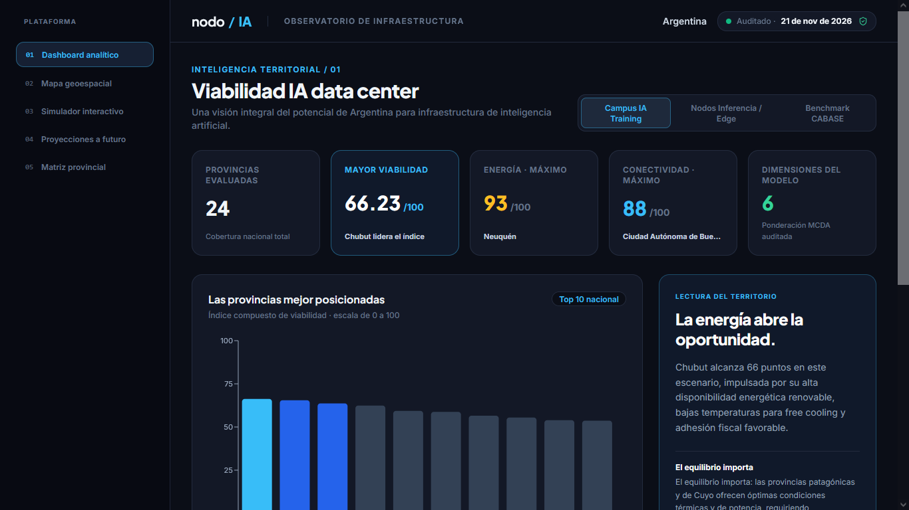
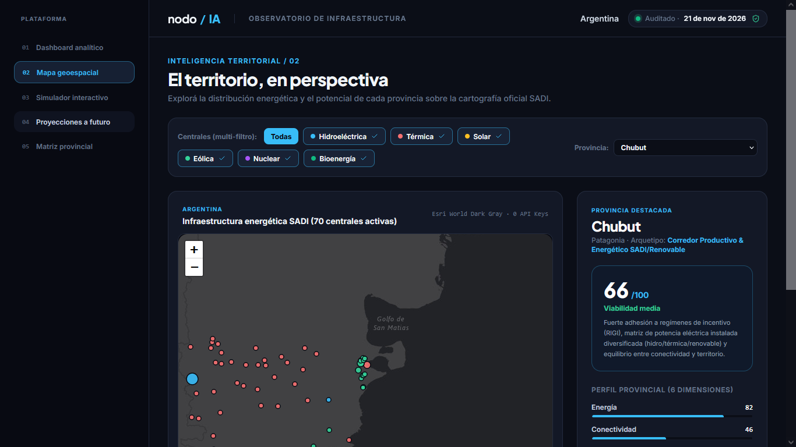
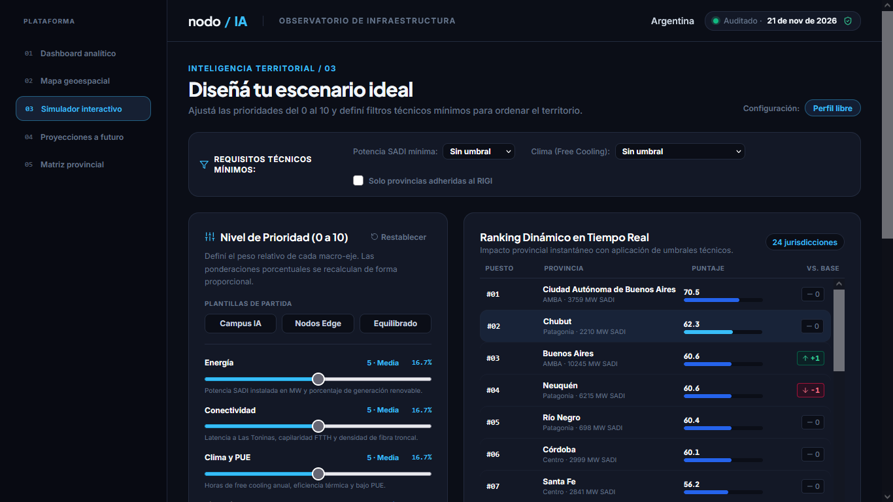
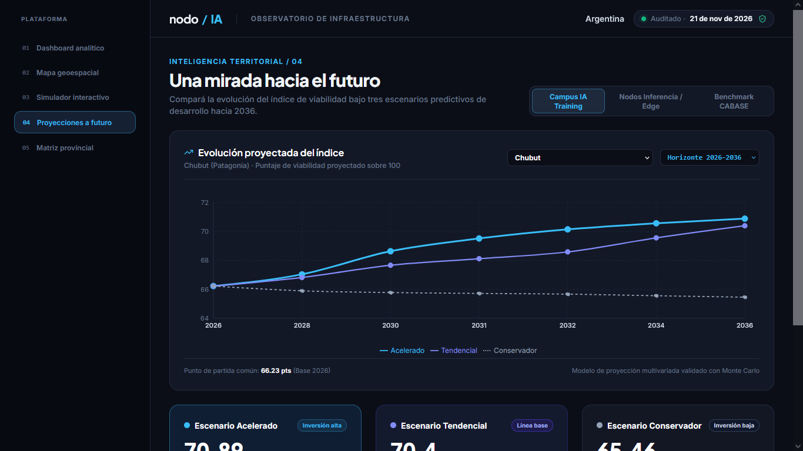
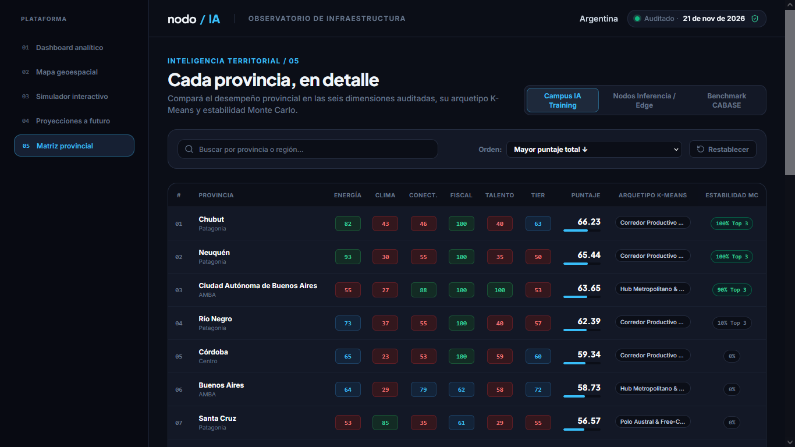

# nodo / IA — Observatorio de Viabilidad de Data Centers IA en Argentina

[](docs/CHANGELOG.md)
[](https://python.org)
[](https://react.dev)
[](https://tailwindcss.com)
[](.github/workflows)
[](https://viabilidad-ia-datacenters-ar.vercel.app)
[-10b981?style=flat-square)](https://epsg.io/4326)
[](bi/guia_powerbi_modelo_estrella.md)

> 🌐 **Plataforma Web Oficial en Producción:**  
> ### [👉 Acceder a nodo / IA en Vercel (https://viabilidad-ia-datacenters-ar.vercel.app)](https://viabilidad-ia-datacenters-ar.vercel.app)
> *Observatorio geoespacial, energético y multicriterio (MCDA) de libre acceso para evaluar la viabilidad técnica, climática, regulatoria y territorial para la radicación de infraestructura de Inteligencia Artificial y Centros de Datos en las 24 jurisdicciones de Argentina (23 provincias + CABA).*

---

## 1. Galería Visual de la Plataforma (`v2.1.0`)

La plataforma web oficial implementa una interfaz editorial nocturna de alto contraste orientada a directores de infraestructura, fondos de inversión y tomadores de políticas públicas:

### 01 · Dashboard Ejecutivo Multicriterio

*5 KPIs dinámicos consolidados a nivel país, ranking Top 10 ponderado para Perfil A (Campus IA) y Perfil B (Inferencia Edge), lectura contextualizada del territorio y distribución de las 6 dimensiones auditadas.*

---

### 02 · Cartografía Geoespacial SADI (6 Tecnologías Operativas)

*Capa cartográfica nocturna Esri Dark Gray (EPSG:4326) con 474 centrales del SADI georreferenciadas vectorialmente. Permite filtrar por tecnología (Hidroeléctrica, Eólica, Solar, Térmica CC, Nuclear, Biomasa) con marcadores proporcionales a MW instalados y ficha técnica provincial con zoom reactivo.*

---

### 03 · Simulador Interactivo MCDA & Requisitos Mínimos Técnicos

*Ajuste dinámico de prioridades en escala 0–10 con normalización estricta al 100%. Incorpora filtros duros por Requisitos Mínimos Técnicos (Potencia SADI en MW, umbral de PUE climático máximo y cláusula obligatoria de adhesión al RIGI), deltas de ranking en vivo y Radar Chart hexagonal contrastado contra el Promedio Nacional.*

---

### 04 · Proyecciones Prospectivas Decenales (2026–2036)

*Modelado intertemporal bajo tres escenarios macroeconómicos y regulatorios (Acelerado, Tendencial y Conservador) partiendo de base unificada 2026. Analiza el impacto del ingreso de proyectos RenovAr en construcción, el despliegue de redes FTTH y el desbloqueo off-grid austral.*

---

### 05 · Matriz Provincial Heatmap y Auditoría Dimensional

*Auditoría tabular completa de las 24 jurisdicciones con celdas tipo heatmap para las 6 dimensiones normalizadas [0, 100], cluster de pertenencia K-Means, probabilidad de éxito en simulación Monte Carlo (Top 3 %) y buscador reactivo.*

---

## 2. El Dilema Técnico: Dos Perfiles de Carga Desacoplados

Evaluar la radicación de centros de datos bajo un ranking unidimensional constituye un error de diseño de alto costo. Este observatorio modela formalmente dos arquitecturas de computación con requerimientos de ingeniería contrapuestos:

```
┌───────────────────────────────────────────────────────────────┐
│        PERFIL A: Campus de Entrenamiento IA (HPC / Batch)     │
├───────────────────────────────────────────────────────────────┤
│ • Escala de Potencia: 100 a 500+ MW continuos de base         │
│ • Factor Crítico: Firmeza de despacho 24/7 y costo nivelado   │
│ • Térmica: Free-cooling masivo (PUE < 1.25 para evitar chillers)│
│ • Tolerancia de Red: Tolerante a latencia (> 20 ms)           │
│ • Líderes v2.1.0: #1 Chubut, #2 Neuquén, #3 CABA              │
└───────────────────────────────────────────────────────────────┘
                               ▲
                               │ Requerimientos Técnicos
                               │ Contrapuestos
                               ▼
┌───────────────────────────────────────────────────────────────┐
│        PERFIL B: Nodos de Inferencia / Edge (Baja Latencia)   │
├───────────────────────────────────────────────────────────────┤
│ • Escala de Potencia: 1 a 10 MW distribuidos                  │
│ • Factor Crítico: Ultrabaja latencia (< 5 ms a Las Toninas)   │
│ • Conectividad: Amarres de fibra submarina y presencia de IXPs│
│ • Capital Humano: Concentración de talento Dev y STEM local   │
│ • Líderes v2.1.0: #1 CABA, #2 Buenos Aires, #3 Córdoba        │
└───────────────────────────────────────────────────────────────┘
```

---

## 3. Metodología de Evaluación y Hallazgos `v2.1.0`

### 3.1 Las 6 Macro-Dimensiones Auditadas

1. **⚡ Energía & SADI (Rediseño Operativo Cuatripartito `v2.1.0`):**
   A diferencia de modelos previos basados únicamente en promedios brutos, la versión `v2.1.0` audita la infraestructura eléctrica operativa real mediante 4 sub-pilares:
   $$\text{subscore\_energia} = 0.35 \cdot S_1 (\text{Potencia Firme}) + 0.25 \cdot S_2 (\text{Escala SADI}) + 0.20 \cdot S_3 (\text{Matriz Limpia}) + 0.20 \cdot S_4 (\text{Gas Operativo 2025})$$
   - **$S_1$ Potencia Firme Despachable (35%):** MW continuos en Nuclear, Hidroeléctrica total, Ciclos Combinados CCGT de alta eficiencia y Bioenergía (aislando fuentes térmicas de baja eficiencia).
   - **$S_2$ Escala Operativa Total SADI (25%):** Capacidad neta interconectada provincial en MW.
   - **$S_3$ Matriz Libre de Carbono ESG (20%):** Participación de generación sin emisiones directas de GEI (RE100 compliant).
   - **$S_4$ Seguridad de Combustible In-Situ (20%):** Extracción provincial anual de gas natural año 2025 completo ($Mm^3$), reconociendo el potencial de autogeneración térmica a boca de pozo (excluyendo formalmente la plataforma continental offshore de Estado Nacional).

2. **❄️ Eficiencia Térmica & PUE Climatológico:**
   Simulación termodinámica de horas anuales de *free cooling* ($< 15^\circ\text{C}$) y PUE proyectado sobre 24 años de reanálisis horario diario ERA5 / ECMWF (2000–2023, 8.766 días continuos sin datos sintéticos).

3. **🌐 Conectividad Troncal & Latencia:**
   Distancia geodésica al nodo de amarre submarino de Las Toninas (Buenos Aires), capilaridad de accesos de fibra óptica (FTTH) y velocidad media de bajada (ENACOM).

4. **📜 Marco Fiscal & Régimen RIGI:**
   Adhesión formal de cada legislatura provincial a la Ley 27.742 (Régimen de Incentivo para Grandes Inversiones - RIGI) y tratamiento de alícuotas del Impuesto sobre los Ingresos Brutos (IIBB) para servicios informáticos.

5. **👥 Talento STEM & Riesgo Operativo:**
   Densidad de empleo formal registrado en software y servicios IT (CLAE 62, CEP XXI) sobre población, contrastado con la zonificación sísmica oficial de la Norma INPRES-CIRSOC 103 (Zona 0 a Zona 4).

6. **🛡️ Aptitud Territorial Tier (*Tier-Readiness*):**
   Marco conceptual que cuantifica la facilidad territorial para certificar infraestructuras de misión crítica Tier III / Tier IV sin incurrir en sobrecostos prohibitivos de ingeniería:
   > **Deslinde Técnico Mandatorio:** El Uptime Institute **no** certifica territorios ni ciudades, sino topologías de instalaciones físicas específicas (*facilities*). El indicador *Tier-Readiness* evalúa la presencia de condiciones habilitantes: Redundancia Eléctrica Territorial (30%), Estabilidad Sísmica de Sitio (25%), Resiliencia Térmica Estival (25%) y Madurez de Acometidas de Fibra (20%).

---

### 3.2 Principales Movimientos del Ranking (`v2.0` $\rightarrow$ `v2.1`)

| Jurisdicción | Rank A (v2.0) | Rank A (v2.1) | $\Delta$ Rank A | Subscore Energía v2.1 | Razón del Movimiento v2.1.0 |
|:---|:---:|:---:|:---:|:---:|:---|
| **Chubut** | #2 | **#1** | **+1** 🟢 | **81.95** | Gran potencia firme (Futaleufú y eólica continua), gas operativo y óptimo PUE térmico. |
| **Neuquén** | #8 | **#2** | **+6** 🟢 | **92.93** | **Salto histórico:** 35.391 $Mm^3$ de gas (Vaca Muerta, 74,8% del gas continental) + 5.902 MW de base hidroeléctrica del Comahue. |
| **CABA** | #3 | **#3** | 0 ⚪ | **54.66** | Solidez de red urbana y máxima estabilidad, aunque condicionada en espacio físico. |
| **Río Negro** | #6 | **#4** | **+2** 🟢 | **72.95** | Elevada potencia hidroeléctrica firme del Comahue y cuenca gasífera activa. |
| **Córdoba** | #5 | **#5** | 0 ⚪ | **64.55** | Central Nuclear Embalse (648 MW), ciclos combinados y matriz diversificada. |
| **Santa Cruz** | #1 | **#7** | **-6** 🔴 | **52.92** | Conserva el mejor PUE continental, pero cede posiciones al ponderar potencia firme despachable y gas provincial frente al Comahue. |

*En el **Perfil B (Nodos Edge)**, **CABA (#1, 81.58 pts)**, **Buenos Aires (#2, 63.89 pts)** y **Córdoba (#3, 59.17 pts)** ratifican su liderazgo indiscutido debido a la concentración de tráfico y proximidad al cable submarino.*

---

### 3.3 Validación Estadística y Modelado Avanzado

- **Clustering No Supervisado (K-Means, $k=4$, Silhouette = 0.4784):**
  Identifica 4 arquetipos territoriales puros:
  1. *Hub Metropolitano & Conectividad Core* (CABA, Buenos Aires): Concentración de tráfico, fibra y talento.
  2. *Polo Austral & Free-Cooling Extremo* (Santa Cruz, Tierra del Fuego): Ventaja térmica masiva para campus IA.
  3. *Corredor Productivo & Energético SADI* (16 provincias): Base territorial RIGI, potencia hidroeléctrica y renovable.
  4. *Brecha Fiscal e Infraestructura Rezagada* (Formosa, La Pampa, La Rioja, Santiago del Estero): Sin RIGI y déficit de infraestructura troncal.
- **Sensibilidad Estocástica Monte Carlo (1.000 iteraciones):**
  Perturbación simétrica del $\pm 20\%$ sobre las ponderaciones multicriterio para evaluar estabilidad: CABA muestra un **100% de probabilidad** de ser #1 en Inferencia Edge; Chubut y Neuquén consolidan resiliencia estadística en el Top 3 de Campus IA.
- **Proyecciones Prospectivas (2026–2036):**
  Evaluación longitudinal a través de horizontes bianuales en 3 escenarios. Destaca el potencial condicionado de **Tierra del Fuego**, que en un escenario Acelerado con microrredes eólicas *off-grid* salta del puesto #19 en 2026 al puesto #2 en 2036 (+17 posiciones).

---

### 3.4 Transparencia Metodológica y Cero Datos Inventados

En cumplimiento estricto del principio de **Cero Datos Inventados** (`AGENTS.md`), la tabla maestra consolida 48 variables completas de fuentes oficiales, 1 nulo justificado y 13 variables técnicas formalmente auditadas en `NaN` por inexistencia de series abiertas unificadas para las 24 provincias (ej. SAIDI/SAIFI provincial fuera del AMBA o capacidades dinámicas en barras de 500 kV).

#### Fuentes Oficiales Auditadas y Fechas de Corte Reales (`data_freshness.json`):

| Dimensión | Fuente Oficial Auditada | Frecuencia | Fecha de Corte Real | Notas Técnicas de Auditoría |
|---|---|:---:|:---:|---|
| **Clima & PUE** | **ECMWF / Open-Meteo ERA5 Reanalysis** | Diaria | `2023-12-31` | Serie histórica horaria continua 2000–2023 (8.766 días). |
| **Energía SADI** | **Secretaría de Energía / CAMMESA** | Anual | `2026-09-22` | 474 centrales georreferenciadas vigentes en el SADI. |
| **Gas Operativo** | **Secretaría de Energía / SESCO Cap. IV** | Mensual | `2025-12-31` | Extracción anual 2025 completa ($Mm^3$). Excluye plataforma offshore federal. |
| **Conectividad** | **ENACOM / Datos Abiertos** | Trimestral | `2026-06-30` | Accesos FTTH, penetración y velocidad media (2026-T2). |
| **Talento STEM** | **CEP XXI / Ministerio de Economía** | Mensual | `2023-11-01` | Puestos formales en Software CLAE 62 (último reporte público). |
| **Sismicidad** | **INPRES (Norma CIRSOC 103)** | Reglamentaria | `2024-01-01` | Peligrosidad sísmica oficial categorizada de Zona 0 a Zona 4. |
| **Marco RIGI** | **Boletines Oficiales Provinciales / Ley 27.742** | Legislativa | `2026-11-20` | 18 provincias formalmente adheridas y leyes provinciales IIBB. |

---

## 4. Arquitectura del Sistema y Flujo Desacoplado

El proyecto opera bajo un diseño desacoplado que separa el motor de cómputo matemático de las plataformas de consumo final:

```
┌────────────────────────────────────────────────────────────────────────┐
│                        FUENTES OFICIALES AUDITADAS                     │
│    CAMMESA · Sec. Energía · ERA5 ECMWF · ENACOM · CEP XXI · INPRES    │
└───────────────────────────────────┬────────────────────────────────────┘
                                    │
                                    ▼
┌────────────────────────────────────────────────────────────────────────┐
│                     PIPELINE ETL & MODELADO (Python)                   │
│   src/etl/   •   src/gis/ (EPSG:4326)   •   src/modeling/ (MCDA 6D)   │
│   K-Means (k=4)  •  Monte Carlo (1.000)  •  Proyecciones 2026–2036    │
└───────────────────────────────────┬────────────────────────────────────┘
                                    │ Generación de Contratos Versionados
         ┌──────────────────────────┴──────────────────────────┐
         ▼                                                     ▼
┌──────────────────────────────────────┐     ┌───────────────────────────────────┐
│     CONTRATO WEB INMUTABLE           │     │    MODELO ESTRELLA ANALÍTICO      │
│  web/src/data/ivid_payload.json      │     │    data/04_outputs/pbi_ready/     │
│  (Tipado TypeScript, 0 backend API)  │     │    (CSV UTF-8-SIG para BI)        │
└──────────────────┬───────────────────┘     └─────────────────┬─────────────────┘
                   │                                           │
                   ▼                                           ▼
┌──────────────────────────────────────┐     ┌───────────────────────────────────┐
│       FRONTEND JAMSTACK (React)      │     │       POWER BI DESKTOP            │
│   Vite + Tailwind CSS + Recharts     │     │   Modelo Dimensional Estrella     │
│   Leaflet (Esri Dark Gray Tiles)     │     │   DAX Optimizado · bi/theme_dark  │
│   Despliegue CD en Vercel            │     │   Consumo ejecutivo local         │
└──────────────────────────────────────┘     └───────────────────────────────────┘
```

---

## 5. Instalación y Ejecución Local

### 5.1 Requisitos Previos
- **Python 3.10+** (recomendado Python 3.13) con entorno virtual `.venv`.
- **Node.js 18+** (recomendado Node 20+) y **npm**.
- **Git**.

### 5.2 Ejecución de la Plataforma Web React (`web/`)
```bash
# 1. Navegar a la carpeta frontend
cd web

# 2. Instalar dependencias
npm install

# 3. Iniciar entorno de desarrollo local
npm run dev

# 4. Compilar bundle de producción optimizado
npm run build
```
La aplicación quedará disponible en `http://localhost:5173/`.

### 5.3 Pipeline de Datos y Validaciones (Python)
```bash
# 1. Activar entorno virtual
.venv\Scripts\activate      # En Windows
# source .venv/bin/activate # En Linux / macOS

# 2. Ejecutar el pipeline de punta a punta (ETL + Modelado + Payloads)
python src/pipeline/run_full_pipeline.py --mode full

# 3. Correr validaciones automáticas de calidad
python src/etl/validate_master.py data/03_processed/master_24_jurisdicciones.parquet
python src/modeling/validate_mcda.py
python src/modeling/validate_fase3.py
python src/modeling/validate_forecasting.py
```

### 5.4 Notas de Arquitectura
- **Respaldo Legado Streamlit:** La aplicación Streamlit original (`app/main.py`, v1.0.0) se conserva en el repositorio como respaldo histórico y entorno interactivo de validación estadística rápida (`streamlit run app/main.py`).
- **Reserva de Módulo Financiero:** La carpeta `src/finance/` permanece formalmente reservada para una futura fase del proyecto orientada a simulaciones de CAPEX/OPEX y esquemas de amortización acelerada del RIGI.

---

## 6. Documentación Adicional

- 📄 [Auditoría Energética v2.1.0 vs v2.0.0](docs/auditoria_energia_v2_1.md)
- 📄 [Marco Metodológico de Aptitud Territorial Tier (Tier-Readiness)](docs/metodologia_tier.md)
- 📄 [Resultados del Modelado Predictivo Prospectivo 2026–2036](docs/resultados_forecasting_v2.md)
- 📄 [Guía Técnica de Modelo Estrella en Power BI](bi/guia_powerbi_modelo_estrella.md)
- 📄 [Registro Histórico de Cambios (CHANGELOG.md)](docs/CHANGELOG.md)
- 📄 [Contrato de Frescura y Auditoría de Datos](data/04_outputs/data_freshness.json)

---

*Proyecto desarrollado bajo estándares de Ciencia de Datos y gobernanza reproducible (`AGENTS.md`).*
