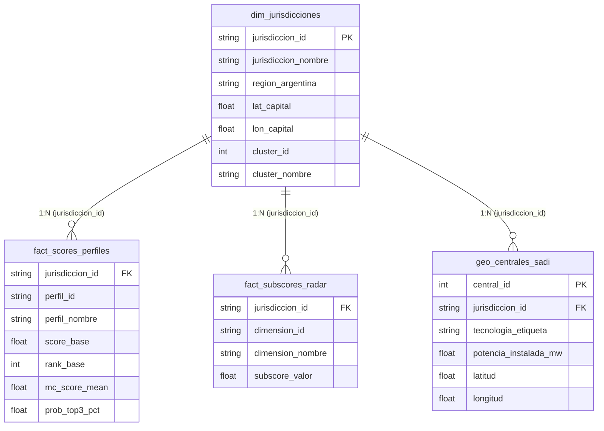

# Guía Técnica de Armado en Power BI — Modelo Estrella (Fase 4 / MVP v1.0.0)

**Proyecto:** Viabilidad de Data Centers y Campus de Inteligencia Artificial en Argentina  
**Rol:** Especialista UX/BI & PMO  
**Versión:** `v1.0.0`  
**Directorio de Datos:** `data/04_outputs/pbi_ready/`  
**Tema Dark-Mode Oficial:** `bi/theme_dark_ivid.json`  

---

## 1. Introducción y Arquitectura del Modelo Estrella

La capa de Business Intelligence de este proyecto consume datos desacoplados, precalculados y normalizados producidos por el pipeline de Ciencia de Datos en Python (Fases 2 y 3). 

El modelo de datos se estructura como un **Esquema en Estrella (Star Schema)** puro, compuesto por:
- **1 Tabla de Dimensión Conforme:** `dim_jurisdicciones` (grano: 1 fila por jurisdicción territorial argentina, 24 registros).
- **3 Tablas de Hechos Transaccionales y Geoespaciales:**
  - `fact_scores_perfiles`: Resultados de scoring determinístico y estocástico (grano: 24 jurisdicciones × 3 perfiles = 72 registros).
  - `fact_subscores_radar`: Valores normalizados [0, 100] de las 5 macro-dimensiones analíticas (grano: 24 jurisdicciones × 5 dimensiones = 120 registros).
  - `geo_centrales_sadi`: Parque de generación eléctrica monitoreado por CAMMESA georreferenciado en WGS84 (grano: 474 centrales SADI).

> [!IMPORTANT]
> **Regla de Oro de Gobernanza (AGENTS.md §4.6):**
> **Nunca duplicar el motor MCDA en DAX.** Los cálculos matriciales, la transformación logarítmica para atenuar asimetrías, la ponderación de sub-scores y las simulaciones Monte Carlo residen exclusivamente en Python (`src/modeling/`). Las medidas DAX en Power BI se limitan a agregar, filtrar y dinamizar los hechos precomputados.

---

## 2. Ingesta y Tipado en Power Query (M)

### 2.1 Origen de Datos
1. Abrir **Power BI Desktop**.
2. Ir a **Inicio > Obtener datos > Texto o CSV**.
3. Importar de a uno los 4 archivos ubicados en `data/04_outputs/pbi_ready/`:
   - `dim_jurisdicciones.csv`
   - `fact_scores_perfiles.csv`
   - `fact_subscores_radar.csv`
   - `geo_centrales_sadi.csv`

### 2.2 Parámetros de Ingesta Obligatorios
- **Codificación de archivo:** `65001: Unicode (UTF-8)` (los archivos fueron exportados con firma `UTF-8-SIG` para preservar tildes y caracteres especiales).
- **Delimitador:** Coma `,`.
- **Detección de tipo de datos:** Basada en todo el conjunto de datos.

### 2.3 Tipado Estricto de Columnas por Tabla

> [!WARNING]
> **Preservación de Códigos INDEC:** Por defecto, Power Query puede detectar la columna `jurisdiccion_id` como número entero, eliminando el cero a la izquierda (`02` $\rightarrow$ `2`). Se debe forzar el tipo a **Texto** en las 4 tablas antes de aplicar las relaciones.

#### Tabla 1: `dim_jurisdicciones`
| Columna | Tipo de Dato (Power Query) | Categoría de Datos (Modelado) | Descripción / Notas |
|---|---|---|---|
| `jurisdiccion_id` | **Texto (String)** | Ninguna | Clave Primaria (PK), formato 2 dígitos (`02` a `94`) |
| `jurisdiccion_nombre` | Texto | Estado o provincia | Nombre oficial de la provincia / CABA |
| `jurisdiccion_corta` | Texto | Ninguna | Nombre corto para etiquetas de gráficos |
| `region_argentina` | Texto | Ninguna | Macrorregión (AMBA, Centro, Cuyo, NEA, NOA, Patagonia) |
| `lat_capital` | Número decimal | **Latitud** | Coordenada WGS84 capital provincial |
| `lon_capital` | Número decimal | **Longitud** | Coordenada WGS84 capital provincial |
| `cluster_id` | Número entero | Ninguna | Identificador numérico del cluster K-Means (1 a 4) |
| `cluster_nombre` | Texto | Ninguna | Arquetipo de infraestructura |
| `cluster_descripcion` | Texto | Ninguna | Justificación estratégica del arquetipo |

#### Tabla 2: `fact_scores_perfiles`
| Columna | Tipo de Dato (Power Query) | Descripción / Notas |
|---|---|---|
| `jurisdiccion_id` | **Texto (String)** | Clave Foránea (FK) |
| `jurisdiccion_nombre` | Texto | Atributo descriptivo (para auditoría) |
| `jurisdiccion_corta` | Texto | Atributo corto |
| `region_argentina` | Texto | Atributo regional |
| `perfil_id` | Texto | Identificador técnico (`campus_ia_training`, `nodo_inferencia_edge`, `benchmark_cabase`) |
| `perfil_nombre` | Texto | Nombre descriptivo del perfil para slicers |
| `score_base` | Número decimal | Score compuesto final determinístico [0.0, 100.0] |
| `rank_base` | Número entero | Posición en el ranking nacional (1 a 24) |
| `mc_score_mean` | Número decimal | Score promedio en simulación Monte Carlo (1.000 runs) |
| `mc_score_std` | Número decimal | Desviación estándar del score Monte Carlo |
| `mc_score_p5` | Número decimal | Percentil 5 (límite inferior intervalo 90% confianza) |
| `mc_score_p95` | Número decimal | Percentil 95 (límite superior intervalo 90% confianza) |
| `mc_rank_median` | Número entero | Ranking mediano en Monte Carlo |
| `prob_top3_pct` | Número decimal | Probabilidad empírica (%) de clasificar en Top 3 |
| `prob_top5_pct` | Número decimal | Probabilidad empírica (%) de clasificar en Top 5 |

#### Tabla 3: `fact_subscores_radar`
| Columna | Tipo de Dato (Power Query) | Descripción / Notas |
|---|---|---|
| `jurisdiccion_id` | **Texto (String)** | Clave Foránea (FK) |
| `jurisdiccion_corta` | Texto | Etiqueta de provincia |
| `dimension_id` | Texto | Identificador dimensional (`subscore_energia`, `subscore_clima`, etc.) |
| `dimension_nombre` | Texto | Etiqueta ejecutiva para ejes de Radar Chart |
| `subscore_valor` | Número decimal | Valor normalizado [0.0, 100.0] de la macro-dimensión |

#### Tabla 4: `geo_centrales_sadi`
| Columna | Tipo de Dato (Power Query) | Categoría de Datos (Modelado) | Descripción / Notas |
|---|---|---|---|
| `central_id` | Número entero | Ninguna | Identificador unívoco CAMMESA |
| `nombre` | Texto | Ninguna | Nombre comercial de la central generadora |
| `central` | Texto | Ninguna | Código de nodo CAMMESA |
| `jurisdiccion_id` | **Texto (String)** | Ninguna | Clave Foránea (FK) |
| `jurisdiccion_nombre` | Texto | Estado o provincia | Nombre provincial |
| `tecnologia` | Texto | Ninguna | Código tecnológico (EO, FV, HI, HI>50, HI<50, CC, TG, TV, DI, NU, BG, BM) |
| `tecnologia_etiqueta` | Texto | Ninguna | Etiqueta limpia (Eólica, Fotovoltaica, Hidroeléctrica, Térmica, etc.) |
| `potencia_instalada_mw` | Número decimal | Ninguna | Capacidad nominal instalada en Megavatios |
| `latitud` | Número decimal | **Latitud** | Coordenada WGS84 del punto de conexión |
| `longitud` | Número decimal | **Longitud** | Coordenada WGS84 del punto de conexión |
| `fuente` | Texto | Ninguna | Origen oficial (`cammesa`) |

---

## 3. Esquema de Relaciones (Star Schema)

En la vista de **Modelo** de Power BI Desktop, configurar las siguientes relaciones:



### Configuración de Cada Relación:
1. **Relación 1:** `dim_jurisdicciones[jurisdiccion_id]` (1) $\rightarrow$ `fact_scores_perfiles[jurisdiccion_id]` (*)  
   - Cardinalidad: `Uno a varios (1:*)`
   - Dirección del filtro cruzado: `Única`
   - Activa: `Sí`
2. **Relación 2:** `dim_jurisdicciones[jurisdiccion_id]` (1) $\rightarrow$ `fact_subscores_radar[jurisdiccion_id]` (*)  
   - Cardinalidad: `Uno a varios (1:*)`
   - Dirección del filtro cruzado: `Única`
   - Activa: `Sí`
3. **Relación 3:** `dim_jurisdicciones[jurisdiccion_id]` (1) $\rightarrow$ `geo_centrales_sadi[jurisdiccion_id]` (*)  
   - Cardinalidad: `Uno a varios (1:*)`
   - Dirección del filtro cruzado: `Única`
   - Activa: `Sí`

---

## 4. Tabla de Medidas DAX (`_Medidas`)

Crear una tabla vacía llamada `_Medidas` (mediante **Inicio > Especificar datos**) y crear en ella las siguientes medidas DAX listas para producción:

### 4.1 KPIs de Infraestructura Eléctrica SADI
```dax
Total Potencia SADI (MW) = 
SUM(geo_centrales_sadi[potencia_instalada_mw])
```

```dax
Total Centrales SADI = 
COUNTROWS(geo_centrales_sadi)
```

```dax
Potencia Renovable SADI (MW) = 
CALCULATE(
    SUM(geo_centrales_sadi[potencia_instalada_mw]),
    geo_centrales_sadi[tecnologia] IN {
        "HI>50", "HI<50", "HI", "EO", "FV", "BG", "BM"
    }
)
```

```dax
% Renovable SADI = 
DIVIDE([Potencia Renovable SADI (MW)], [Total Potencia SADI (MW)], 0)
```

### 4.2 Métricas Dinámicas de Scoring (Sensibles a Slicers)
```dax
Score Promedio Perfil = 
AVERAGE(fact_scores_perfiles[score_base])
```

```dax
Score Maximo Seleccionado = 
MAXX(
    ALLSELECTED(dim_jurisdicciones[jurisdiccion_nombre]),
    [Score Promedio Perfil]
)
```

```dax
Provincia Lider Seleccionada = 
CALCULATE(
    SELECTEDVALUE(dim_jurisdicciones[jurisdiccion_nombre]),
    TOPN(
        1,
        ALLSELECTED(dim_jurisdicciones),
        [Score Promedio Perfil],
        DESC
    )
)
```

```dax
Score Provincia Lider = 
CALCULATE(
    [Score Promedio Perfil],
    TOPN(
        1,
        ALLSELECTED(dim_jurisdicciones),
        [Score Promedio Perfil],
        DESC
    )
)
```

### 4.3 Sub-scores Dimensionales para Radar Chart
```dax
Valor Subscore Dimensional = 
AVERAGE(fact_subscores_radar[subscore_valor])
```

```dax
Subscore Promedio Nacional = 
CALCULATE(
    AVERAGE(fact_subscores_radar[subscore_valor]),
    ALL(dim_jurisdicciones)
)
```

### 4.4 Robustez Monte Carlo
```dax
Probabilidad Media Top 3 = 
DIVIDE(SUM(fact_scores_perfiles[prob_top3_pct]), COUNT(fact_scores_perfiles[prob_top3_pct]), 0) / 100
```

```dax
Probabilidad Media Top 5 = 
DIVIDE(SUM(fact_scores_perfiles[prob_top5_pct]), COUNT(fact_scores_perfiles[prob_top5_pct]), 0) / 100
```

---

## 5. Aplicación del Tema Dark-Mode Oficial (`bi/theme_dark_ivid.json`)

Para que la experiencia visual sea 100% idéntica a la aplicación Streamlit:
1. En Power BI Desktop, ir a la cinta de opciones **Ver**.
2. En la galería de **Temas**, desplegar el menú y hacer clic en **Buscar temas...**
3. Navegar a la carpeta `bi/` del repositorio y seleccionar `theme_dark_ivid.json`.
4. El archivo aplicará de forma automática:
   - Fondo Canvas: `#0e1117`
   - Tarjetas y Contenedores: `#161b22` con borde sutil `#30363d`
   - Tipografía principal: Segoe UI en `#f0f6fc`
   - Paleta cromática: Cian (`#38bdf8`), Esmeralda (`#34d399`), Ámbar (`#fbbf24`), Púrpura Edge (`#c084fc`), Rosa (`#f472b6`), Azul (`#60a5fa`) y Rojo térmico (`#f43f5e`).

---

## 6. Propuesta de Layout Ejecutivo (2 Páginas)

### Página 1: "Tablero Estratégico & Benchmarking Provincial"
**Objetivo:** Permitir al tomador de decisiones comparar las 24 jurisdicciones según el perfil de demanda deseado e identificar el cluster estratégico.

- **Encabezado (Fila 1 - Altura 80 px):**
  - Título ejecutivo: `⚡ VIABILIDAD DE DATA CENTERS & CAMPUS DE IA EN ARGENTINA`.
  - Subtítulo: `Scoring Multicriterio (MCDA), Arquetipos K-Means y Simulación Monte Carlo`.
  - **Slicer de Perfil:** Menú desplegable o botones horizontales vinculados a `fact_scores_perfiles[perfil_nombre]`.
- **KPI Cards Ejecutivas (Fila 2 - 4 Cards):**
  1. **Provincia Líder:** Medida `[Provincia Lider Seleccionada]` + subtítulo con `[Score Provincia Lider]` pts.
  2. **Potencia Total SADI:** Medida `[Total Potencia SADI (MW)]` (formato: `#,,0.0 "GW"` o `39.332 MW`).
  3. **Participación Renovable:** Medida `[% Renovable SADI]` (formato: `0.0%`).
  4. **Parque de Generación:** Medida `[Total Centrales SADI]` (474 centrales activas).
- **Cuerpo Principal (Fila 3 - 2 Columnas):**
  - **Columna Izquierda (Ancho 55%):** Gráfico de barras horizontales (*Clustered Bar Chart*):
    - Eje Y: `dim_jurisdicciones[jurisdiccion_corta]` (ordenado descendente por `[Score Promedio Perfil]`).
    - Eje X: `[Score Promedio Perfil]`.
    - Color de datos: Condicional según `dim_jurisdicciones[cluster_nombre]` o degradado Cian.
    - Filtro visual: Top 10 o las 24 jurisdicciones completas.
  - **Columna Derecha (Ancho 45%):**
    - Superior: Gráfico de dispersión o barras apiladas por `dim_jurisdicciones[cluster_nombre]` mostrando la distribución de las 24 provincias en los 4 arquetipos K-Means.
    - Inferior: Tabla de detalle con `jurisdiccion_nombre`, `region_argentina`, `cluster_nombre`, `Score Base`, `Rank Base`, `Intervalo P5-P95` y `Prob Top 3 (%)`.

---

### Página 2: "Infraestructura SADI & Perfil Dimensional (Radar)"
**Objetivo:** Análisis profundo de la infraestructura física eléctrica y de los 5 sub-scores dimensionales para una provincia en particular.

- **Encabezado y Filtros (Fila 1):**
  - **Slicer 1 (Jurisdicción):** Selector único de `dim_jurisdicciones[jurisdiccion_nombre]`.
  - **Slicer 2 (Tecnología de Generación):** Selector múltiple de `geo_centrales_sadi[tecnologia_etiqueta]`.
- **Cuerpo Principal (Fila 2 - 2 Columnas):**
  - **Columna Izquierda (Ancho 60%):** Mapa de Centrales Eléctricas SADI (*Map / Azure Map*):
    - Latitud: `geo_centrales_sadi[latitud]`.
    - Longitud: `geo_centrales_sadi[longitud]`.
    - Tamaño de burbuja: `geo_centrales_sadi[potencia_instalada_mw]`.
    - Leyenda / Color: `geo_centrales_sadi[tecnologia_etiqueta]`.
    - Tooltips: Nombre de central, tecnología, MW nominales, provincia y fuente CAMMESA.
  - **Columna Derecha (Ancho 40%):**
    - Superior: **Radar Chart** (visual personalizado de AppSource o gráfico de barras comparativo):
      - Eje de categorías: `fact_subscores_radar[dimension_nombre]`.
      - Serie 1 (Provincia): `[Valor Subscore Dimensional]`.
      - Serie 2 (Referencia): `[Subscore Promedio Nacional]`.
    - Inferior: Matriz de Centrales SADI de la jurisdicción seleccionada desglosando Central, Tecnología y Potencia (MW).

---

## 7. Checklist de Validación para Despliegue (.pbix)

- [ ] Las 4 tablas importadas desde `data/04_outputs/pbi_ready/` tienen codificación UTF-8 sin caracteres corruptos.
- [ ] La columna `jurisdiccion_id` tiene formato **Texto** en las 4 tablas.
- [ ] Las columnas de coordenadas geográficas tienen asignadas las categorías de datos *Latitud* y *Longitud*.
- [ ] Las relaciones 1:N son de dirección única y no generan dependencias circulares.
- [ ] El tema `bi/theme_dark_ivid.json` fue aplicado y el contraste visual cumple estándares WCAG.
- [ ] Los totales coinciden con el pipeline de Python:
  - Total MW SADI: `39.332,2 MW`
  - Total centrales: `474`
  - Santa Cruz en Perfil IA: `67.00 pts` (Rank 1)
  - CABA en Perfil Edge: `81.58 pts` (Rank 1)
