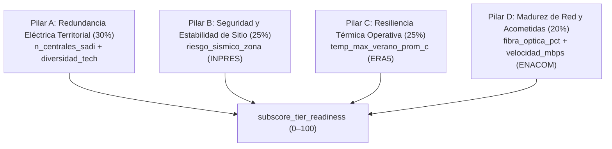

# Marco Metodológico: Aptitud Territorial Tier (Tier-Readiness)

**Versión:** 2.0.0-alpha.1  
**Fecha:** 2026-11-21  
**Autor:** Científico de Datos — Proyecto Viabilidad Data Centers e IA en Argentina  
**Tabla de salida:** `data/04_outputs/scores_mcda_perfiles.parquet` / `dim_jurisdicciones.csv`  

---

## 1. Fundamento Conceptual y Deslinde Técnico

### 1.1 El error de certificar territorios
En la industria de infraestructura tecnológica crítica existe una confusión recurrente: clasificar provincias o regiones geográficas como "provincias Tier III" o "ciudades Tier IV".  

> [!IMPORTANT]
> **El Uptime Institute NO certifica jurisdicciones, ciudades ni territorios.**  
> Uptime Institute certifica exclusivamente la **topología de diseño y la sustentabilidad operativa de una instalación física específica (Data Center Facility)** en sus niveles Tier I a Tier IV:
> - **Tier I (Capacidad Básica):** Camino único de distribución sin componentes redundantes (uptime teórico 99.671%).
> - **Tier II (Capacidad Redundante):** Componentes redundantes $N+1$, pero camino único de distribución (uptime 99.741%).
> - **Tier III (Mantenible Concurrentemente):** Múltiples caminos de distribución independientes de energía y refrigeración, con al menos uno activo; cualquier componente o ducto puede ser intervenido sin detener la carga crítica de IT (uptime 99.982%).
> - **Tier IV (Tolerante a Fallas):** Múltiples caminos activos simultáneos e independientes ($2N$ o $2(N+1)$), compartimentación física y capacidad de absorber eventos imprevistos o fallas sin impacto alguno en la carga de IT (uptime 99.995%).

### 1.2 Definición de Aptitud Territorial Tier (Tier-Readiness)
Definimos **Aptitud Territorial Tier (Tier-Readiness)** como:
> *La medida agregada, cuantitativa y auditable del grado en que las condiciones geográficas, geológicas, climáticas, energéticas y de conectividad de una jurisdicción facilitan a un operador o inversor el diseño, construcción y certificación operativa de instalaciones Tier III y Tier IV sin recurrir a sobrecostos prohibitivos de ingeniería de mitigación.*

Una provincia con alta Aptitud Territorial Tier cuenta con:
1. Múltiples fuentes y tecnologías de generación eléctrica disjuntas en su territorio, reduciendo el riesgo de colapso simultáneo de acometidas (*Common Cause Failure*).
2. Estabilidad geomecánica y sísmica de sitio (peligrosidad reducida según norma INPRES-CIRSOC 103), evitando anclajes de aislamiento sísmico hiper-complejos en racks, generadores y tuberías de agua helada.
3. Resiliencia climática estival, que previene el estrés térmico extremo en sistemas de enfriamiento continuo (*Continuous Cooling* exigido en Tier III/IV).
4. Capilaridad y velocidad en redes de fibra óptica, lo que garantiza acometidas físicas redundantes por ductos disjuntos y diversidad de operadores neutrales (*carrier-neutrality*).

---

## 2. Pilares Constitutivos y Formulación Matemática

El subscore de Aptitud Territorial Tier (`subscore_tier_readiness`) se modela en escala normalizada $[0, 100]$ a partir de cuatro pilares construidos con variables oficiales auditadas (cero datos inventados):

### 2.1 Pilar A — Redundancia Eléctrica Territorial ($w_A = 0.30$)
Tier III y IV exigen acometidas de energía independientes y confiables. Para evaluar la resiliencia de la red territorial mayorista, se evalúan dos métricas derivadas de `data/04_outputs/pbi_ready/geo_centrales_sadi.csv`:
1. **Volumen de nodos de generación:** $\ln(1 + \text{n\_centrales\_sadi})$. La transformación logarítmica mitiga el sesgo de escala de grandes jurisdicciones.
2. **Diversidad de tecnologías de generación:** $\text{sadi\_diversidad\_tech}$, contabilizando cuántas tecnologías distintas (hidro, eólica, solar, térmica CC/TG/TV, nuclear, biomasa) operan en la provincia. Una alta diversidad garantiza que fallas climáticas o de suministro de gas no apaguen el 100% de la capacidad local.
3. **Tratamiento estricto de Tierra del Fuego:** Por tratarse de un sistema eléctrico insular no interconectado al SADI (decisión D6), registra 0 centrales SADI y 0 tecnologías SADI ($0.0 \text{ pts}$ en este componente), modelando con rigor su condición de isla energética.

$$N_{\text{redundancia\_electrica}} = 0.50 \cdot \text{scale\_min\_max}(\ln(1 + \text{n\_centrales\_sadi})) + 0.50 \cdot \text{scale\_min\_max}(\text{sadi\_diversidad\_tech})$$

### 2.2 Pilar B — Estabilidad Sísmica y de Sitio ($w_B = 0.25$)
La certificación Tier IV exige tolerancia a fallas mecánicas catastróficas. El movimiento sísmico severo amenaza transformadores, baterías de UPS, tuberías presurizadas de refrigeración y acoplamientos rígidos de generadores.
- **Variable fuente:** `riesgo_sismico_zona` (Zonificación INPRES-CIRSOC 103, Zona 0 a Zona 4).
- **Polaridad:** Minimización (Zona 0 = máxima estabilidad, Zona 4 = severo riesgo).

$$N_{\text{seguridad\_sitio}} = \text{scale\_min\_max}(\text{riesgo\_sismico\_zona}, \text{direction}='minimize')$$

| Zona CIRSOC 103 | Peligrosidad Sísmica | Puntaje Normalizado ($N_{\text{seguridad\_sitio}}$) | Provincias Ejemplo |
| :---: | :--- | :---: | :--- |
| **Zona 0** | Muy Reducida | **100.0** | CABA, Buenos Aires, Entre Ríos, Corrientes, Santa Fe |
| **Zona 1** | Reducida | **75.0** | Córdoba, Chaco, Formosa, Neuquén, Río Negro, Chubut |
| **Zona 2** | Moderada | **50.0** | Catamarca, La Rioja (parcial), Tucumán |
| **Zona 3** | Elevada | **25.0** | Salta, Jujuy, Tierra del Fuego |
| **Zona 4** | Muy Elevada | **0.0** | San Juan, Mendoza |

### 2.3 Pilar C — Resiliencia Térmica Operativa ($w_C = 0.25$)
Uptime Institute estipula que los centros de datos Tier III y IV deben disponer de refrigeración continua (*Continuous Cooling*), asegurando que durante una conmutación de red o pico de demanda térmica, el aire en sala blanca no exceda los límites de ASHRAE TC 9.9.  
En zonas con olas de calor extremo ($> 35^\circ\text{C}$), los chillers sufren desrating de capacidad, mayor presión en condensadores y un consumo parásito que eleva la probabilidad de desenganche térmico.
- **Variable fuente:** `temp_max_verano_prom_c` (Promedio de temperaturas máximas estivales DJF 2000–2023, Open-Meteo ERA5 / ECMWF).
- **Polaridad:** Minimización (menor temperatura estival $\implies$ mayor resiliencia y menor estrés en chillers).

$$N_{\text{resiliencia\_termica}} = \text{scale\_min\_max}(\text{temp\_max\_verano\_prom\_c}, \text{direction}='minimize')$$

### 2.4 Pilar D — Madurez de Acceso de Red y Acometidas ($w_D = 0.20$)
Tier III y IV exigen al menos dos acometidas de telecomunicaciones subterráneas físicamente independientes que ingresen por *Meet-Me Rooms* (MMR) separadas por muros corta-fuego. La penetración de fibra óptica (`fibra_optica_pct`) y la velocidad media (`velocidad_media_bajada_mbps`) de ENACOM actúan como proxy auditado de la madurez del ecosistema de telecomunicaciones local y la disponibilidad de ductos troncales modernos.

$$N_{\text{madurez\_red}} = 0.50 \cdot \text{scale\_min\_max}(\text{fibra\_optica\_pct}) + 0.50 \cdot \text{scale\_min\_max}(\text{velocidad\_media\_bajada\_mbps})$$

---

## 3. Manejo de Colinealidad y Justificación de Independencia Analítica

Dado que variables como `temp_max_verano_prom_c`, `riesgo_sismico_zona`, `fibra_optica_pct` y `velocidad_media_bajada_mbps` intervienen en las dimensiones preexistentes, es mandatorio auditar y justificar la colinealidad.

### 3.1 Justificación Conceptual: Dotación Bruta vs. Aptitud de Misión Crítica
- **Dimensión Clima:** Evalúa el potencial de ahorro energético anual y PUE (`pue_climatologico_estimado` basado en horas totales $< 15^\circ\text{C}$). Una provincia puede tener excelente free-cooling invernal pero sufrir picos estivales extremos que comprometan la continuidad operativa.
- **Dimensión Energía:** Evalúa la potencia instalada agregada bruta (MW) y participación renovable (%). No evalúa si esa potencia proviene de una sola megacentral (punto único de falla) o de una red diversificada con múltiples puntos de interconexión.
- **Dimensión Conectividad:** Evalúa distancia a Las Toninas (latencia internacional). Tier-Readiness evalúa la infraestructura capilar local para doble acometida.
- **Dimensión Talento & Riesgo:** Combina puestos de software y sismicidad. En Tier-Readiness, la sismicidad se evalúa como integridad estructural de equipos de potencia y enfriamiento continuo.

### 3.2 Auditoría Empírica de Correlaciones
Matriz de correlación de Pearson entre las 6 dimensiones calculada sobre las 24 jurisdicciones:

| Dimensión | Energía | Clima | Conectividad | Fiscal | Talento/Riesgo | Tier-Readiness |
| :--- | :---: | :---: | :---: | :---: | :---: | :---: |
| **subscore_energia** | 1.000 | 0.020 | 0.374 | 0.148 | 0.031 | **0.294** |
| **subscore_clima** | 0.020 | 1.000 | -0.198 | -0.052 | -0.210 | **0.034** |
| **subscore_conectividad** | 0.374 | -0.198 | 1.000 | 0.252 | 0.638 | **0.582** |
| **subscore_fiscal** | 0.148 | -0.052 | 0.252 | 1.000 | 0.180 | **0.234** |
| **subscore_talento_riesgo** | 0.031 | -0.210 | 0.638 | 0.180 | 1.000 | **0.660** |
| **subscore_tier_readiness** | **0.294** | **0.034** | **0.582** | **0.234** | **0.660** | **1.000** |

**Conclusiones de la auditoría:**
- Ninguna correlación supera el umbral crítico de multicolinealidad ($r \ge 0.75$).
- Las correlaciones moderadas con Conectividad ($r = 0.582$) y Talento/Riesgo ($r = 0.660$) responden a la realidad de infraestructura: los hubs con mayor desarrollo urbano y telecomunicaciones suelen situarse en zonas de llanura con bajo riesgo sísmico.
- Sin embargo, provincias patagónicas con alto clima (Chubut, Santa Cruz) obtienen excelentes puntajes en Tier-Readiness por su bajo riesgo sísmico y clima estival fresco, desacoplándose de la dimensión puramente metropolitana.

---

## 4. Trazabilidad de Variables de Entrada

| Variable | Tipo | Optimización | Archivo Origen | Función en Tier-Readiness |
| :--- | :--- | :---: | :--- | :--- |
| `n_centrales_sadi` | `float64` | $\uparrow$ | `master_24_jurisdicciones.parquet` | Redundancia de nodos generadores |
| `sadi_diversidad_tech` | `int64` | $\uparrow$ | `geo_centrales_sadi.csv` | Diversificación de matriz tecnológica provincial |
| `riesgo_sismico_zona` | `int64` | $\downarrow$ | `master_24_jurisdicciones.parquet` | Integridad de sitio e inmunidad a fallas mecánicas |
| `temp_max_verano_prom_c` | `float64` | $\downarrow$ | `master_24_jurisdicciones.parquet` | Estabilidad de enfriamiento continuo (*Continuous Cooling*) |
| `fibra_optica_pct` | `float64` | $\uparrow$ | `master_24_jurisdicciones.parquet` | Capilaridad para rutas disjuntas |
| `velocidad_media_bajada_mbps` | `float64` | $\uparrow$ | `master_24_jurisdicciones.parquet` | Modernidad de troncales y ancho de banda local |

*Cumplimiento innegociable de AGENTS.md: Cero datos sintéticos o inventados.*
