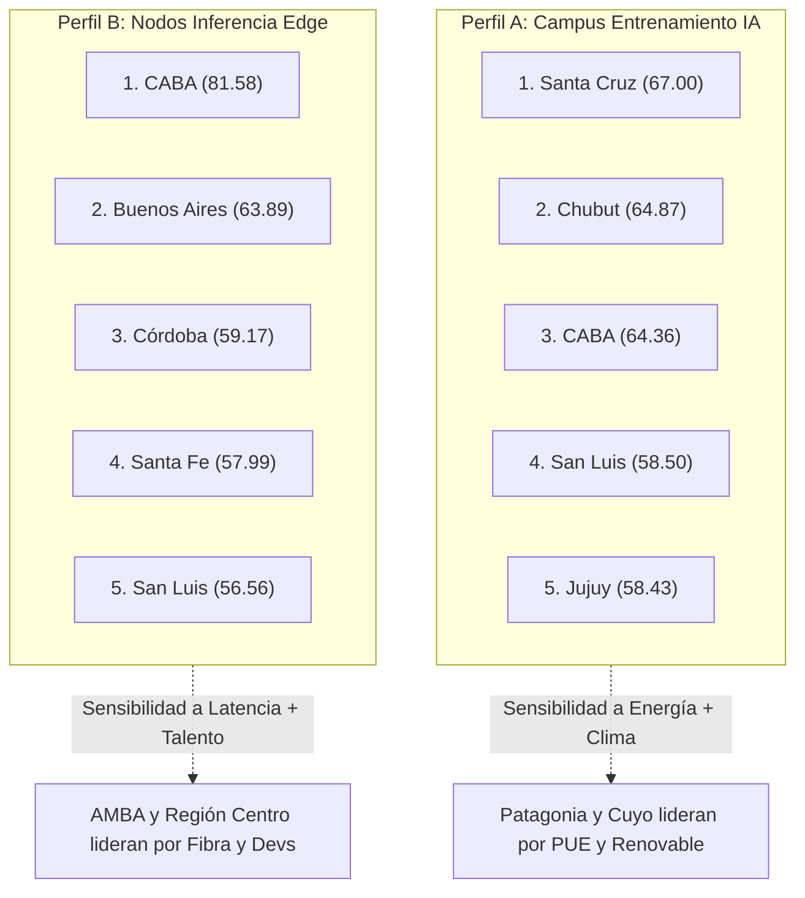

# Reporte Ejecutivo de Resultados — Motor MCDA Multi-Perfil (v0.6.0)
## Fase 3 — Bloque 3.1: Preprocesamiento Estadístico y Scoring Multicriterio

**Rol:** Científico de Datos  
**Fecha de corte:** 2026-11-20  
**Datasets analizados:** `data/03_processed/master_24_jurisdicciones.parquet` (Fase 2)  
**Outputs generados:** `data/04_outputs/scores_mcda_perfiles.parquet` y `.csv`  
**Configuración de pesos:** `config/weights_profiles.json`  

---

## 1. Resumen Ejecutivo y Hallazgos Principales

El Bloque 3.1 implementó con éxito el motor matemático de decisión multicriterio (**MCDA - Multi-Criteria Decision Analysis**) bajo la metodología **WSM (Weighted Sum Model)** jerárquico en dos niveles:
1. Normalización de 14 features operativas completas [0, 100] con tratamiento de asimetría mediante transformación logarítmica ($\ln(1+x)$) para evitar que los polos de CABA y Provincia de Buenos Aires anulen al resto de las provincias.
2. Cálculo de **5 sub-scores dimensionales** (Energía, Clima/PUE, Conectividad, Fiscal/Regulatorio y Talento/Riesgo).
3. Evaluación de tres perfiles de demanda contrastantes sobre las 24 jurisdicciones argentinas:
   - **Perfil A — Campus de Entrenamiento IA (`campus_ia_training`):** Prioriza disponibilidad energética SADI/renovable (35%), eficiencia térmica PUE / free cooling (25%) e incentivos fiscales / RIGI (20%).
   - **Perfil B — Nodos de Inferencia / Edge (`nodo_inferencia_edge`):** Prioriza baja latencia a cables submarinos y fibra óptica (35%), capital humano IT / mitigación sísmica (25%) e incentivos fiscales (15%).
   - **Perfil C — Benchmark CABASE (`benchmark_cabase`):** Ponderación uniforme y equilibrada (20% en cada una de las 5 dimensiones) como referencia estructural de portafolio.

### Conclusiones Estratégicas Clave:
- **Divergencia Territorial según Perfil de Carga:** El modelo demuestra cuantitativamente que **la ubicación óptima depende radicalmente de la naturaleza del centro de cómputo**. Para *Entrenamiento IA (Perfil A)*, la Patagonia austral y central (**Santa Cruz #1** con 67.00 pts y **Chubut #2** con 64.87 pts) superan a los distritos centrales gracias a su PUE climatológico récord (< 1.25) y gran penetración eólica/renovable. Por el contrario, para *Inferencia Edge (Perfil B)*, la zona metropolitana y el corredor centro (**CABA #1** con 81.58 pts y **Buenos Aires #2** con 63.89 pts) dominan de manera indiscutida por cercanía a Las Toninas, capilaridad de fibra y masa crítica de programadores.
- **El caso de Tierra del Fuego:** Al modelar fielmente su condición de sistema eléctrico provincial no interconectado (0.0 MW SADI $\rightarrow$ subscore Energía = 0.0), TDF queda clasificada en el puesto #19 en Entrenamiento (41.99 pts) y #21 en Inferencia (29.42 pts). Aunque ostenta el PUE más eficiente del país (1.24) y un régimen fiscal inmejorable (Ley 19.640, score fiscal 100), el modelo evidencia que un campus de IA requeriría inversión intensiva en generación eléctrica cautiva aislada (*off-grid*), hipótesis que será testeada en la Fase 5 (Monte Carlo).
- **Provincias del Centro y Cuyo con Alto Desempeño:** **San Luis (#4 en Training, #5 en Edge)**, **Córdoba (#7 en Training, #3 en Edge)** y **Neuquén (#6 en Training, #8 en Edge)** emergen como jurisdicciones con balance excepcional entre solidez fiscal (adhesión al RIGI confirmada), generación eléctrica estructurada y conectividad troncal.
- **El piso de competitividad (Bottom 5):** **Formosa (puesto 24)** y **Santiago del Estero (puesto 23)** se ubican en la base de los tres rankings debido a una confluencia de factores adversos: no adhesión al RIGI, climas con veranos extremos (> 32°C que encarecen el enfriamiento mecánico) y baja penetración de fibra óptica.

---

## 2. Rankings Comparativos por Perfil

### 2.1 Perfil A: Campus de Entrenamiento IA (`campus_ia_training`)
*Pesos: Energía (35%), Clima/PUE (25%), Fiscal (20%), Conectividad (10%), Talento/Riesgo (10%)*

#### Top 10 Jurisdicciones:
| Rank | Jurisdicción | Score Final | Sub-Energía (35%) | Sub-Clima (25%) | Sub-Fiscal (20%) | Sub-Conectividad (10%) | Sub-Talento/Riesgo (10%) |
|:---:|:---|:---:|:---:|:---:|:---:|:---:|:---:|
| **1** | **Santa Cruz** | **67.00** | 78.00 | 84.90 | 60.63 | 34.53 | 28.93 |
| **2** | **Chubut** | **64.87** | 73.08 | 42.74 | 100.00 | 45.90 | 40.21 |
| **3** | **CABA** | **64.36** | 53.49 | 27.33 | 100.00 | 88.08 | 100.00 |
| **4** | **San Luis** | **58.50** | 67.37 | 23.06 | 100.00 | 62.49 | 29.11 |
| **5** | **Jujuy** | **58.43** | 70.04 | 37.84 | 100.00 | 26.19 | 18.38 |
| **6** | **Neuquén** | **56.59** | 57.40 | 29.67 | 100.00 | 55.38 | 35.43 |
| **7** | **Córdoba** | **56.47** | 55.20 | 23.48 | 100.00 | 53.43 | 59.37 |
| **8** | **Río Negro** | **56.45** | 50.56 | 36.72 | 100.00 | 55.28 | 40.48 |
| **9** | **Buenos Aires** | **55.92** | 64.68 | 29.17 | 61.67 | 78.73 | 57.84 |
| **10** | **San Juan** | **54.90** | 67.71 | 18.80 | 100.00 | 51.82 | 13.24 |

#### Bottom 5 Jurisdicciones:
| Rank | Jurisdicción | Score Final | Sub-Energía | Sub-Clima | Sub-Fiscal | Sub-Conectividad | Sub-Talento/Riesgo |
|:---:|:---|:---:|:---:|:---:|:---:|:---:|:---:|
| **20** | Misiones | **35.47** | 18.01 | 3.88 | 100.00 | 41.81 | 40.16 |
| **21** | La Pampa | **35.24** | 52.64 | 29.33 | 2.86 | 52.42 | 36.63 |
| **22** | La Rioja | **31.58** | 62.57 | 17.47 | 2.86 | 28.63 | 18.79 |
| **23** | Santiago del Estero | **21.22** | 39.93 | 2.18 | 2.86 | 33.44 | 27.79 |
| **24** | Formosa | **15.78** | 26.41 | 0.60 | 0.00 | 29.57 | 34.31 |

---

### 2.2 Perfil B: Nodos de Inferencia / Edge (`nodo_inferencia_edge`)
*Pesos: Conectividad (35%), Talento/Riesgo (25%), Fiscal (15%), Energía (15%), Clima/PUE (10%)*

#### Top 10 Jurisdicciones:
| Rank | Jurisdicción | Score Final | Sub-Conectividad (35%) | Sub-Talento/Riesgo (25%) | Sub-Fiscal (15%) | Sub-Energía (15%) | Sub-Clima (10%) |
|:---:|:---|:---:|:---:|:---:|:---:|:---:|:---:|
| **1** | **CABA** | **81.58** | 88.08 | 100.00 | 100.00 | 53.49 | 27.33 |
| **2** | **Buenos Aires** | **63.89** | 78.73 | 57.84 | 61.67 | 64.68 | 29.17 |
| **3** | **Córdoba** | **59.17** | 53.43 | 59.37 | 100.00 | 55.20 | 23.48 |
| **4** | **Santa Fe** | **57.99** | 54.81 | 57.97 | 100.00 | 51.81 | 15.42 |
| **5** | **San Luis** | **56.56** | 62.49 | 29.11 | 100.00 | 67.37 | 23.06 |
| **6** | **Chubut** | **56.35** | 45.90 | 40.21 | 100.00 | 73.08 | 42.74 |
| **7** | **Río Negro** | **55.72** | 55.28 | 40.48 | 100.00 | 50.56 | 36.72 |
| **8** | **Neuquén** | **54.82** | 55.38 | 35.43 | 100.00 | 57.40 | 29.67 |
| **9** | **Entre Ríos** | **50.60** | 45.52 | 44.85 | 100.00 | 44.67 | 17.55 |
| **10** | **Corrientes** | **50.27** | 43.48 | 46.70 | 100.00 | 52.82 | 4.53 |

#### Bottom 5 Jurisdicciones:
| Rank | Jurisdicción | Score Final | Sub-Conectividad | Sub-Talento/Riesgo | Sub-Fiscal | Sub-Energía | Sub-Clima |
|:---:|:---|:---:|:---:|:---:|:---:|:---:|:---:|
| **20** | La Pampa | **38.77** | 52.42 | 36.63 | 2.86 | 52.64 | 29.33 |
| **21** | Tierra del Fuego | **29.42** | 14.33 | 15.62 | 70.00 | 0.00 | 100.00 |
| **22** | La Rioja | **26.28** | 28.63 | 18.79 | 2.86 | 62.57 | 17.47 |
| **23** | Santiago del Estero | **25.29** | 33.44 | 27.79 | 2.86 | 39.93 | 2.18 |
| **24** | Formosa | **22.95** | 29.57 | 34.31 | 0.00 | 26.41 | 0.60 |

---

### 2.3 Perfil C: Benchmark CABASE / Línea Base Sectorial (`benchmark_cabase`)
*Pesos homogéneos: 20% por dimensión (Energía, Clima, Conectividad, Fiscal, Talento/Riesgo)*

#### Top 10 Jurisdicciones:
| Rank | Jurisdicción | Score Final | Sub-Energía | Sub-Clima | Sub-Conectividad | Sub-Fiscal | Sub-Talento/Riesgo |
|:---:|:---|:---:|:---:|:---:|:---:|:---:|:---:|
| **1** | **CABA** | **73.78** | 53.49 | 27.33 | 88.08 | 100.00 | 100.00 |
| **2** | **Chubut** | **60.39** | 73.08 | 42.74 | 45.90 | 100.00 | 40.21 |
| **3** | **Buenos Aires** | **58.42** | 64.68 | 29.17 | 78.73 | 61.67 | 57.84 |
| **4** | **Córdoba** | **58.30** | 55.20 | 23.48 | 53.43 | 100.00 | 59.37 |
| **5** | **Santa Cruz** | **57.40** | 78.00 | 84.90 | 34.53 | 60.63 | 28.93 |
| **6** | **Río Negro** | **56.61** | 50.56 | 36.72 | 55.28 | 100.00 | 40.48 |
| **7** | **San Luis** | **56.41** | 67.37 | 23.06 | 62.49 | 100.00 | 29.11 |
| **8** | **Santa Fe** | **56.00** | 51.81 | 15.42 | 54.81 | 100.00 | 57.97 |
| **9** | **Neuquén** | **55.58** | 57.40 | 29.67 | 55.38 | 100.00 | 35.43 |
| **10** | **Entre Ríos** | **50.52** | 44.67 | 17.55 | 45.52 | 100.00 | 44.85 |

---

## 3. Análisis Comparativo: Entrenamiento IA vs. Inferencia Edge

### Principales Desplazamientos Relativos:
1. **Santa Cruz:**
   - En Entrenamiento: **Puesto #1** (67.00 pts).
   - En Inferencia: **Puesto #11** (48.60 pts).
   - *Explicación:* Sufre una caída de 10 posiciones debido a la penalización por distancia a Las Toninas (~2.040 km) y menor densidad de programadores locales, variables prioritarias en Edge.
2. **Buenos Aires:**
   - En Inferencia: **Puesto #2** (63.89 pts).
   - En Entrenamiento: **Puesto #9** (55.92 pts).
   - *Explicación:* Aunque posee la mayor potencia eléctrica absoluta del país (10.2 GW), su clima estival cálido (PUE 1.48) y la no adhesión al RIGI nacional (atenuada parcialmente por el RPI provincial) la relegan frente al sur en entrenamiento masivo.
3. **CABA:**
   - En Inferencia: **Puesto #1 indiscutido** (81.58 pts, 17.7 puntos de ventaja sobre el segundo).
   - En Entrenamiento: **Puesto #3** (64.36 pts).
   - *Explicación:* La insuperable concentración de infraestructura troncal y talento TIC la mantiene competitiva en cualquier perfil, pero el costo de disipación térmica y la saturación de espacio limitan su viabilidad para un megacampus de 100+ MW.
4. **San Luis:**
   - En Entrenamiento: **Puesto #4** (58.50 pts).
   - En Inferencia: **Puesto #5** (56.56 pts).
   - *Explicación:* Es una de las provincias más resilientes y balanceadas del país: adhesión plena al RIGI, infraestructura digital propia, riesgo sísmico moderado/bajo y matriz energética diversificada.

---

## 4. Trazabilidad Técnica y Calidad de Datos

- **Cero Datos Faltantes:** 100% de los 24 registros territoriales procesados sin un solo valor nulo (`NaN`).
- **Invariante de Pesos:** Comprobación automática en `src/modeling/mcda_engine.py` de que la suma de ponderaciones cumpla $\sum w_i = 1.0 \pm 10^{-6}$.
- **Archivos Persistidos:**
  - `data/04_outputs/scores_mcda_perfiles.parquet` (6.2 KB, compresión Snappy, 24 filas × 17 columnas).
  - `data/04_outputs/scores_mcda_perfiles.csv` (3.8 KB, UTF-8 con BOM para ingesta inmediata en Excel y Power BI).
- **Consistencia Matemática:**
  - Suite de validación ejecutada en `src/modeling/validate_mcda.py` con 7/7 pruebas aprobadas (`PASS`).
  - Todos los sub-scores y scores finales se encuentran estrictamente contenidos en $[0.0, 100.0]$.

---

*Reporte elaborado por el Científico de Datos — Aprobado para alimentar el Bloque 3.2 (Clustering K-Means / PCA).*
